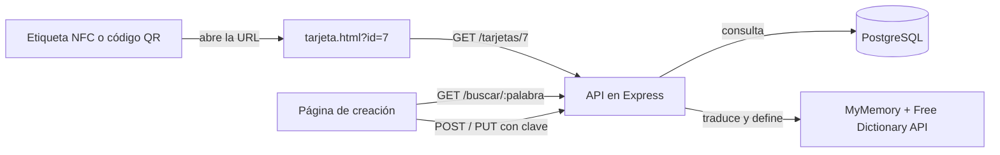

> Aprende vocabulario en inglés sin abrir ninguna app. Acerca el teléfono y aparece su traducción, definición, ejemplos y audio.
>
> Demo: https://tarjetasingles.onrender.com/
>
> -- El problema.
> Aprender inglés exige inmersión al idioma, se requiere estar en contacto con el idioma varias veces a
> lo largo de nuestro día. Sin embargo, las herramientas habituales ponen fricción justo ahí:
>
> - Muchas apps de vocabulario piden una "suscripción" para tener funcionalidades verdaderamente útiles.
> - Casi todas obligan a abrir la app, buscar y elegir la tarjeta antes de praccticar.
> - Las tarjetas suelen ser fijas no podemos editarlas con libertad.
>
> # La solución
> Apoyado con la tecnología de NFC, cada objeto de la casa se puede colocar una etiqueta NFC.
> Al acercar el teléfono se abre directamente la tarjeta de ese objeto.
>
>  - La palabra en español y su **traducción al inglés**.
>  - La **definición** en inglés.
>  - **Oraciones de ejemplo**
>  - **Audio** para escuchar y repetir
>
> Lo mejor si no te gusta o quieres cambiar alguna ejemplo o la traducción, eres libre de hacerlo.
>
> ## Cómo funciona



1. **Crear:** escribes una palabra en español, la API la traduce (esto depende de la API, ya que no muestra todas las traducciones al ser una API de uso gratuito
2. presenta limitaciones, al igual al correrlo de forma local presenta menos inconveniente de conexión ya que en un servidor gratuito cambia de direccion ip y la api de memory a llegado a bloquear
3. el axeso a la tradcuccion) busca su definición.
4. Puedes editar cualquier campo y añadir ejemplos propios. Al guardar, se te muestra la URL de la tarjeta.
5. **Usar:** grabas esa URL en una etiqueta NFC, o imprimes su código QR.
6. **Estudiar:** acercas el teléfono y se abre la tarjeta, con audio para repetir.

## Funcionalidades

- Búsqueda con **traducción automática y definición** de cualquier palabra.
- **Edición manual** de la traducción, la definición y los ejemplos antes y después de guardar.
- **Escritura protegida** con una clave de edición; la lectura es pública para que la etiqueta pueda abrir la tarjeta sin iniciar sesión.
- Script para **cargar tarjetas de golpe** con sus ejemplos.
- **Ejemplos** escritos por el usuario, con su traducción opcional, y un reverso de la tarjeta donde se muestran.
- **Audio** de la frase con la voz del navegador (Web Speech API), repetible varias veces.
- **URL estable** por tarjeta: el identificador nunca se reutiliza, así que una etiqueta ya pegada no deja de funcionar.


## Tecnologías

| Capa | Tecnología |
|---|---|
| Servidor | Node.js y Express |
| Base de datos | PostgreSQL (alojada en Neon) con el paquete `pg` |
| Interfaz | HTML, CSS y JavaScript sin frameworks |
| Audio | Web Speech API (`speechSynthesis`) |
| Traducción | [MyMemory](https://mymemory.translated.net/doc/spec.php) |
| Definiciones | [Free Dictionary API](https://dictionaryapi.dev/) |
| Publicación | Render (servidor) y Neon (base de datos) |

## API

Base: https://tarjetasingles.onrender.com/

| Método | Ruta | Descripción | ¿Requiere clave? |
|---|---|---|---|
| `GET` | `/buscar/:palabra` | Traduce una palabra del español al inglés y devuelve su definición | No |
| `GET` | `/tarjetas` | Lista todas las tarjetas | No |
| `GET` | `/tarjetas/:id` | Devuelve una tarjeta | No |
| `POST` | `/tarjetas` | Crea una tarjeta | Sí |
| `PUT` | `/tarjetas/:id` | Actualiza una tarjeta **sin cambiar su `id`** | Sí |

Las rutas que escriben exigen la cabecera `x-clave`. Sin ella, o con una incorrecta, responden `401`.

**Ejemplo**

```bash
curl https://TU-DIRECCION.onrender.com/tarjetas/1
```

```json
{
  "id": 1,
  "palabra": "puerta",
  "traduccion": "Door",
  "definicion": "A hinged barrier used to close off an entrance.",
  "ejemplo": "Please close the door."
}
```

<!-- TODO: ajusta el JSON de ejemplo a lo que devuelve tu API realmente, incluyendo la columna de ejemplos adicionales -->

**Códigos de estado usados:** `200` correcto, `201` creado, `400` datos incompletos, `401` clave incorrecta, `404` no encontrado, `502` falló un servicio externo.

## Instalación local

**Requisitos:** Node.js 20.6 o superior y una base de datos PostgreSQL (por ejemplo, un proyecto gratuito en [Neon](https://neon.com)).

```bash
git clone https://github.com/TU-USUARIO/tarjetasIngles.git
cd tarjetasIngles
npm install
cp .env.example .env     # y completa los valores
node --env-file=.env servidor.js
```

Abre `http://localhost:3000/`.

### Variables de entorno

| Variable | Obligatoria | Descripción |
|---|---|---|
| `DATABASE_URL` | Sí | Cadena de conexión de PostgreSQL |
| `CLAVE_EDICION` | Sí | Clave para crear y editar tarjetas. Usa una larga y aleatoria |
| `PORT` | No | Puerto del servidor (por defecto `3000`) |
| `MYMEMORY_EMAIL` | No | Correo para ampliar el límite diario de traducción |
| `BASE_URL` | No | Dirección pública, para generar enlaces y códigos QR |

Genera una clave segura con:

```bash
node -e "console.log(require('crypto').randomBytes(24).toString('hex'))"
```

### Base de datos

```sql
CREATE TABLE tarjetas (
  id SERIAL PRIMARY KEY,
  palabra TEXT NOT NULL,
  traduccion TEXT NOT NULL,
  definicion TEXT NOT NULL DEFAULT '',
  ejemplo TEXT NOT NULL DEFAULT ''
);
```

<!-- TODO: añade aquí la columna de ejemplos adicionales con su tipo real -->

### Cargar tarjetas de ejemplo

```bash
node --env-file=.env cargar_tarjetas.js
```

<!-- TODO: confirma el nombre y el uso del script de carga -->

## Cómo grabar una etiqueta NFC

1. Crea una tarjeta y copia su dirección con el botón **Copiar**.
2. Con una app que escriba etiquetas NFC, añade un registro de tipo **URL** y pega esa dirección.
3. Acerca el teléfono a la etiqueta para comprobarlo.

No bloquees la etiqueta contra escritura: así podrás regrabarla si algún día cambia la dirección del proyecto.

## Seguridad

- Las consultas SQL usan **parámetros** (`$1`, `$2`...), nunca texto pegado: protege contra inyección SQL.
- El contenido que viene de fuera se inserta con `textContent`, no con `innerHTML`: protege contra XSS.
- La clave de edición vive en el servidor como variable de entorno. `.env` está en `.gitignore` y nunca se sube al repositorio.
- Si falta `CLAVE_EDICION` o `DATABASE_URL`, el servidor **se niega a arrancar**, en lugar de quedar desprotegido.

## Decisiones técnicas

- **La etiqueta guarda una URL, no el contenido.** Por eso editar una tarjeta no obliga a regrabar la etiqueta, y la dirección tiene que ser estable.
- **PostgreSQL en lugar de un archivo JSON.** Los servidores gratuitos borran su disco al reiniciarse. Además, una columna `SERIAL` nunca reutiliza un número, lo que garantiza que una etiqueta pegada jamás apunte a otra tarjeta.
- **El servidor hace de intermediario con las APIs externas.** El navegador nunca habla con MyMemory ni con el diccionario, y los datos sensibles no salen del servidor.
- **Lectura pública y escritura protegida.** La etiqueta no puede enviar credenciales, así que abrir una tarjeta debe ser libre.

## Limitaciones conocidas

- Con el plan gratuito que use de Render, el servidor **se duerme un lapso de 15 minutos sin uso** y la primera visita puede tardar alredodor de un minuto.
- MyMemory limita el uso diario gratuito. Si se agota, la traducción automática falla, aunque se puede escribir a mano.
- Solo ofrece definiciones en inglés.
- La voz del navegador depende del dispositivo.


## Créditos

- Definiciones: [Free Dictionary API](https://dictionaryapi.dev/).
- Traducciones: [MyMemory](https://mymemory.translated.net/).

